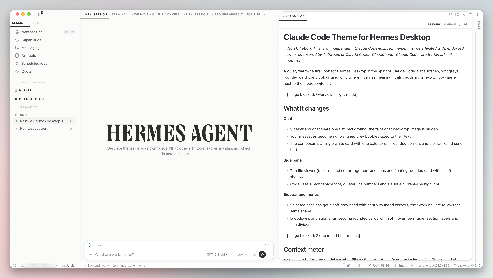
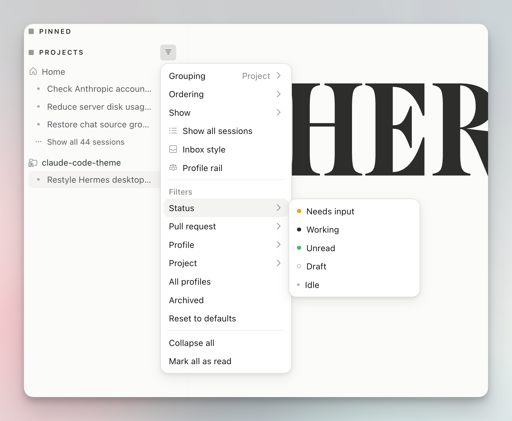
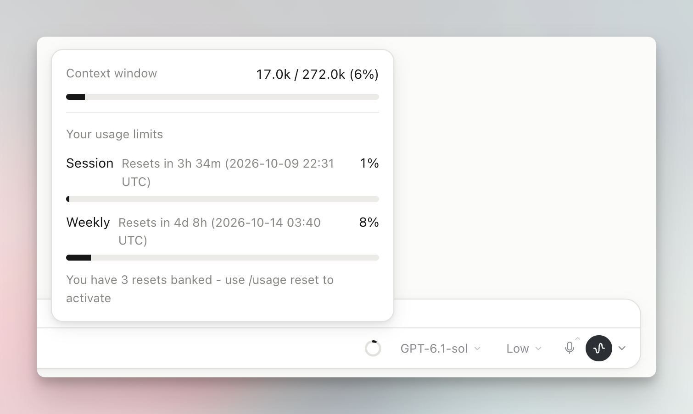

# Claude Code Theme for Hermes Desktop

> **No affiliation.** This is an independent, Claude Code-inspired theme. It is not affiliated with, endorsed by, or sponsored by Anthropic or Claude Code. "Claude" and "Claude Code" are trademarks of Anthropic.

A quiet, warm-neutral look for Hermes Desktop in the spirit of Claude Code: flat surfaces, soft greys, rounded cards, and colour used only where it carries meaning. It also adds a context-window meter next to the model switcher.



## What it changes

**Chat**
- Sidebar and chat share one flat background; the faint chat backdrop image is hidden.
- Your messages become right-aligned grey bubbles sized to their text.
- The composer is a single white card with one pale border, rounded corners and a black round send button.

**Side panel**
- The file viewer (tab strip and editor together) becomes one floating rounded card with a soft shadow.
- Code uses a monospace font, quieter line numbers and a subtle current-line highlight.

**Sidebar and menus**
- Selected sessions get a soft grey band with gently rounded corners; the "working" arc follows the same shape.
- Dropdowns and submenus become rounded cards with soft hover rows, quiet section labels and thin dividers.



## Context meter

A small ring before the model switcher fills as the current chat's context window fills (it turns red above 85%). Click it to see:

- **Context window:** tokens used, model maximum and percentage.
- **Your usage limits:** session and weekly limits with reset times, when your provider reports them through Hermes.



The meter only reads what Hermes already knows (`session.usage`). Providers without a usage API show "No limit data from this provider".

## Light and dark

Every colour has a light and a dark value and follows your Appearance setting (Light, Dark or System).

## Settings

**Settings → Plugins → Claude Code Theme**

- **Custom accent colour** (off by default): when on, sets the accent for light and dark mode separately. When off, your skin's accent is used.
- **Reset to defaults.**

## Install

```bash
hermes plugins install aliilhami/hermes-claude-code-theme
```

Then enable **Claude Code Theme** in Settings → Plugins. To remove it, disable or uninstall it there; nothing else is changed.

## Disclosure

- No network calls of its own, no credentials, no shell commands, no background processes.
- Stores only its own accent preference, through the plugin storage API.
- Styling targets Hermes Desktop markup with CSS, so a Desktop update may change some details. Issues and pull requests welcome.

## Licence

MIT. See [LICENSE](LICENSE).
